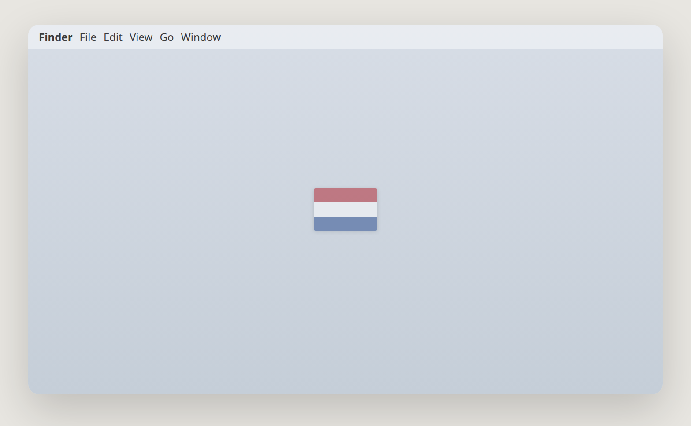
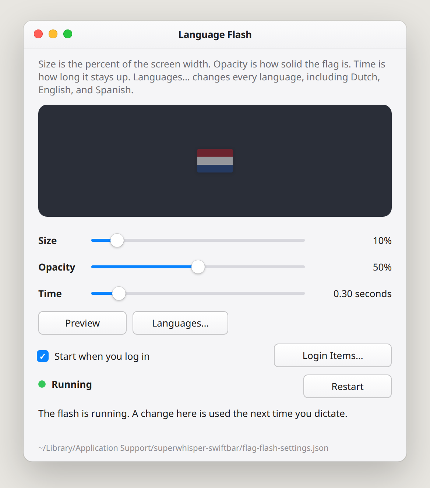
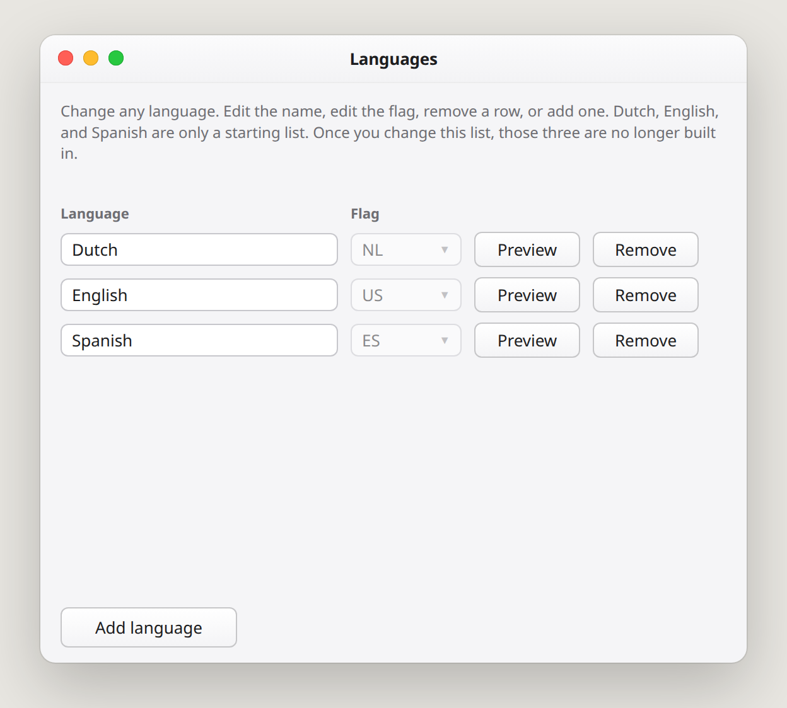
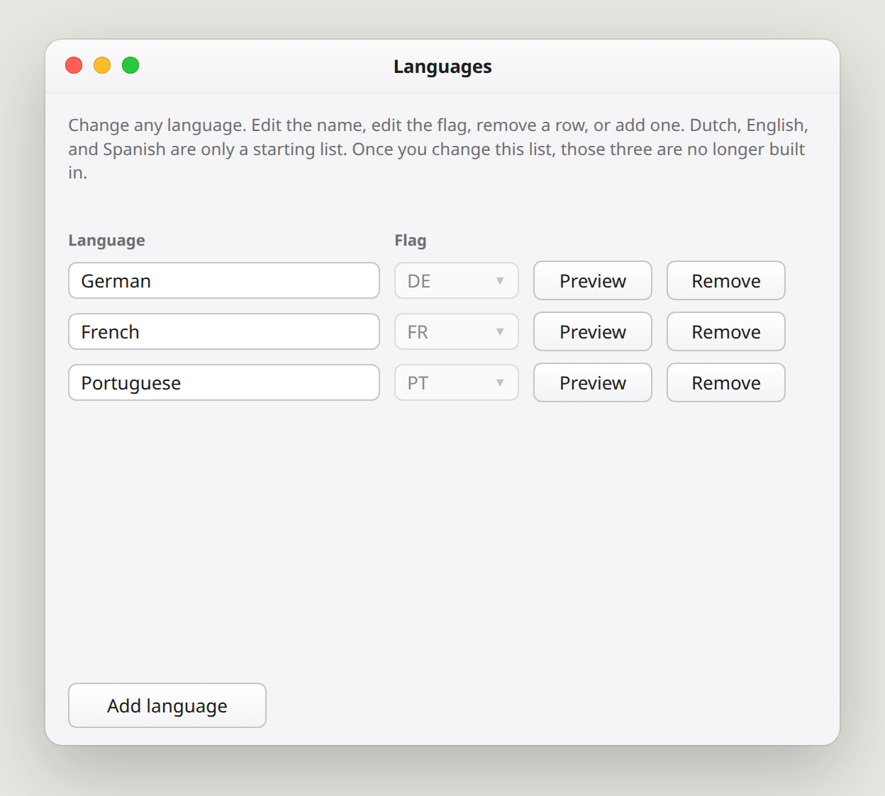

# Language Flash

for Superwhisper

Press your dictation key. A flag flashes, so you can see the language before you speak.



Open **Language Flash** in Applications.

Drag the sliders to change the size, how see-through the flag is, and how long it stays. **Preview** shows it. Green **Running** means it is on.



**Languages…** is your list. Change any name. Change any flag. Remove one, or add one. Dutch, English, and Spanish are only the start.





The next time you dictate, you see the new flag.

## Put it on your Mac

Open Terminal, paste this, and press Return.

```bash
cd "$HOME/.local/src/superwhisper-swiftbar" && git pull && ./bin/install-flag-flash.sh
```

Language Flash appears in Applications. Turn on **Start when you log in**. If no flag appears, allow Language Flash in System Settings → Privacy & Security → Accessibility.
